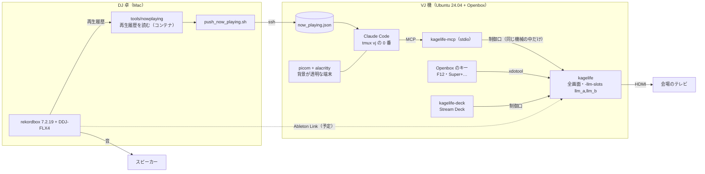
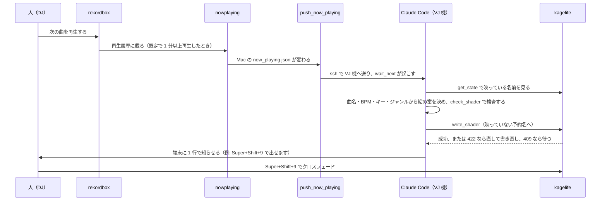

# 運用事例: 人と Claude が一緒に VJ をする構成（2026-11）

2026-11 のライブに向けて、試作機で組んで確かめた構成の記録です。人が DJ をし、VJ 機の上の Claude Code が曲ごとに次のシェーダを書きます。切り替えは人が行います。試作機はこのあと消すので、構成と確かめた結果をここに残します。

## 概要

| 項目 | 内容 |
|---|---|
| 役割 | 人が DJ をして切り替え、Claude が曲ごとにシェーダを書く |
| DJ | Mac の rekordbox 7.2.19 と DDJ-FLX4 |
| VJ | 別の Linux 機で kagelife を全画面に映し、HDMI で会場のテレビへ出す |
| AI | VJ 機の Claude Code が kagelife-mcp を通して書き込む |
| 曲の情報 | rekordbox の再生履歴から取る（会場の音は拾わない） |
| 見せ方 | 背景が透明な端末に Claude Code を映し、VJ の上に重ねる |
| ネットワーク | 持ち込みのルーターの中で、VJ 機は有線（DHCP）。外から手を入れるときは Tailscale を使う。Link は同じネットワークの中でしか届かない |

### 用語

| 言葉 | 意味 |
|---|---|
| 制御口 | kagelife の HTTP の制御 API。同じ機械の中からだけ受け付ける |
| 予約名 | `-llm-slots` で決めた、AI が書き込める名前（ここでは llm_a と llm_b） |
| basic-vj | kagelife-shaders にある 9 本のシェーダの組 |

## 構成図

## 1 曲の流れ

試作機の kagelife-mcp（0.1.0）には write_back_slot が無かったので、back_slot.sh で書く先を決めてから write_shader で書きました。今の dev の kagelife-mcp には write_back_slot があります。

## 部品

| 部品 | 置き場所 | 役目 |
|---|---|---|
| kagelife | VJ 機 | シェーダを全画面に映す。`-llm-slots llm_a,llm_b` で、AI が書ける名前を 2 つに限る |
| kagelife-mcp | VJ 機 | Claude Code と kagelife の制御口をつなぐ stdio の MCP サーバ |
| tools/nowplaying | Mac | rekordbox の master.db を読み取り専用で写し、再生履歴から今の曲を書き出す |
| tools/conductor | Mac・VJ 機 | Claude Code が従う手順書（CONDUCTOR.md）と補助のスクリプト（wait_next・back_slot・check_shader・note_written・push_now_playing） |
| kagelife-shaders | VJ 機 | basic-vj の 9 本と、VJ 機を組むスクリプト（setup-vj-host.sh） |
| kagelife-deck | VJ 機 | Stream Deck から kagelife を操作する |
| picom・alacritty・tmux | VJ 機 | 背景が透明な端末を VJ に重ねる |

## VJ 機の画面とキー

端末は画面の左半分（960x1080）に重なります。英字は Ubuntu Mono、日本語は Noto Sans Mono CJK JP で出します。Super の付いたキーは xdotool で kagelife の窓に送るので、フォーカスは端末のままです。

| キー | 動き |
|---|---|
| F12 | 端末を隠す（VJ だけを見せる）・出す |
| Super+Return / Ctrl+Alt+T | 端末を開く・前に戻す（picom も起動する） |
| Super+1〜7 | basic-vj の 01〜07 に切り替える |
| Super+8 / Super+9 | Claude が書いた llm_a / llm_b に切り替える |
| Super+0 | 予約名を出す前に映っていたシェーダへ戻す |
| Super+Shift+1〜9 | クロスフェードで切り替える |
| Super+Space / Super+H | タップ / HUD の出し入れ |

basic-vj の 08・09 は、キー 8・9 を予約名に使うのでキーでは出しません。出すときは制御口で名前を指定します。

## 安全のための決め事

| 決め事 | 仕組み |
|---|---|
| AI が書けるのは予約名だけ | 予約名以外への書き込みは 403、映っている予約名は 409、コンパイル失敗は 422 で、画面は前のまま |
| 切り替えは人が先 | Claude は頼まれたときだけ切り替える。人の指示は自動の流れより先に従う |
| Claude の権限を絞る | Claude Code の設定（permissions）で `defaultMode` を `dontAsk` にする。許可は kagelife の MCP・指揮のスクリプト・決めたフォルダの読み書きだけ。管理者権限（sudo）と認証情報のファイルは拒否 |
| 画面に秘密を出さない | 端末は客席から見える。トークンやパスワードを表示しない |
| 光の決まり | 画面全体を光らせるのは 1 拍に 1 回まで、1 秒に 3 回を超えない（180 BPM 以下で成り立つ）。毎フレーム変わる Random で全画面を明滅させない |
| シェーダのコメントは ASCII | 端末で日本語のコメントが豆腐になったため、短い英語にする |

## 実測

kagelife の制御口で読んだ fps です（1920x1080、`-render-scale 1.0`）。

| 状態 | 04_warp | ほかの 8 本 |
|---|---|---|
| 何も重ねない | 45 | 60 |
| picom と端末 | 37 | 60 |
| picom と端末で打鍵中 | 35 | 60 |
| OBS で重ねる | 31〜32 | 60 |

- 04_warp だけで GPU の描画を 94〜97% 使います。重ねる仕組みは、合成の負担が小さい picom にしました
- rekordbox 7.2.19 の master.db の再生履歴は、rekordbox を動かしたまま読めました
- kagelife-mcp は、VJ 機の中でも、Mac から ssh 越しでも、write_shader まで通りました
- 仮の曲で、手順書どおりの 1 周（曲を受け取る → 映っていない予約名に書く）を通しました。画面が切り替わっていないことは get_state の active で確かめ、画面そのものは見ていません

## 決めたことと理由

| 決めたこと | 理由 |
|---|---|
| Claude Code を VJ 機で動かす | 人と AI が同じ画面で一緒に操作でき、Claude が書く様子を客席に見せられる |
| `-llm-slots` を使う | 書きかけや失敗作が画面に出ない |
| 曲は rekordbox の再生履歴から取る | 会場でマイクを使うのは見込めず、rekordbox 7.2.18 のマニュアルに今の曲を外へ出す機能が見当たらない |
| 重ねるのは picom | OBS より fps の下がり方が小さい |
| テンポは Ableton Link にする（予定、試作機では未確認） | 音を拾わずに拍を合わせられる |

調べて使わなかったもの: rekordbox のメモリを読む rkbx_link（macOS の 7.2.19 に未対応）、マイクと曲の識別サービス、Claude Code を Mac で動かす形、OBS。

## 確かめていないこと・残った課題

- 明るさの自動検査（光の決まりは、手順書と人の目に頼っている）
- Ableton Link と rekordbox の接続。rekordbox は全デッキを LINK にして使う前提（コントローラの TEMPO では Link の BPM を変えられない）
- Stream Deck の「次の曲」の合図
- 曲が変わってから絵が替わるまでの時間（再生履歴の遅れと書く時間で、1〜2 分の見込み）
- 重ね表示とキーの割り当てを、setup-vj-host.sh に入れること
- 本番の機体と会場の回線
